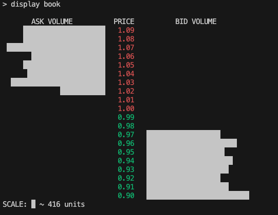
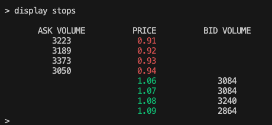
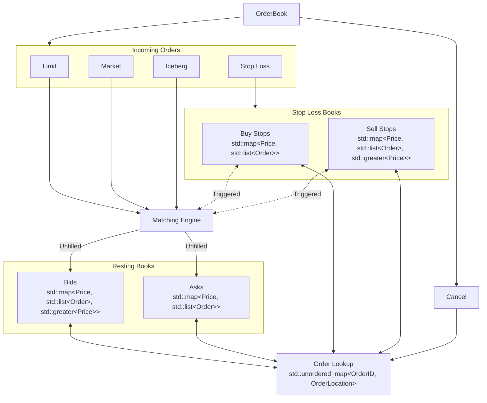

# Limit Order Book

A C++ limit order book with price-time priority matching and an interactive terminal interface. Includes support for limit, market, iceberg, and stop loss order types. Features O(1) cancellation (O(log P) for price-level manipulations), capable of processing ~5M orders/s.

## Background

An order book maintains all outstanding orders for a financial instrument and efficiently executes trades. Buy orders are called *bids* and sell are called *asks*. In addition, an order book should also be able to efficiently cancel orders, retrieve information from the book (e.g. the spread), and record previous transactions.

Each bid specifies the maximum price an investor is willing to pay, while an ask specifies the minimum price a seller is willing to accept. A trade is executed by matching bids and asks by a set of predetermined matching rules, which may depend on the order type. This order book features *price-time priority*, meaning that best (greatest) bid is matched with the best (least) ask. If there are multiple orders at the same price level then orders are given time priority, i.e. FIFO. Depending on the order type, orders that are not matched may either be discarded or inserted into the book waiting to be matched by future incoming orders. The difference between the best resting ask and best resting bid is known as the *spread*.

The current implementation supports the following order types:
- *Limit Order*: The investor specifies the bid/ask price and the quantity. If an existing ask/bid satisfies those constraints they are matched and an order is executed. If there does not exist such an order then the investor's order is placed into the book until it is matched by an incoming order.
- *Market Order*: The investor specifies the total number of units they would like to buy or sell. They are then matched with the current best priced orders in the book. If there are no orders in the book then the rest of the order is discarded. 
- *Iceberg Order*: The investor specifies the bid/ask price, the quantity, as well as a *peak*. An iceberg order behaves like a limit order with the exception that only the peak amount is shown in the book, with the remaining quantity being hidden. Once a peak has been replenished the order loses its time-priority and is now considered the most recent order. Once the peak amount is fulfilled it is replenished and this continues until the hidden quantity is also fulfilled. 
- *Stop Loss Order*: The investor specifies a *stop loss* and the quantity. A stop loss is a price which triggers a market order; when a trade is executed at or exceeding the stop loss then the stop loss is triggered. In the case of a buy, a stop loss is triggered once a trade is executed at the stop loss or higher. The sell case is analogous.

For more information, see [Optiver: Orders and the Order Book](https://www.optiver.com/insights/explainers/orders-and-the-order-book/).

## Build & Installation

**C++ Standard:** C++ 20 or higher.
**Build System:** CMake 3.25 or higher.

1. Clone the repository
```bash
git clone https://github.com/arahimyar/limit-order-book.git
```
2. Go to directory
```bash
cd limit-order-book
```
3. Configure build files
```bash
cmake -B build
```
4. Compile executable
```bash
cmake --build build
```


## Usage

This order book can be used by including `OrderBook.h` and creating an instance of the `OrderBook` class, e.g. 
```C++
#include "OrderBook.h"
OrderBook book;
```
Orders can be added to the book by calling one of the following functions:
```C++
book.buyLimit(id, price, quantity);
book.sellLimit(id, price, quantity);
book.buyMarket(id, quantity);
book.sellMarket(id, quantity);
book.buyIceberg(id, price, quantity, peak);
book.sellIceberg(id, price, quantity, peak);
book.buyStopLoss(id, stopPrice, quantity);
book.sellStopLoss(id, stopPrice, quantity);

```
Where:
- `id` is of `OrderID` type, which is an alias for `std::uint64_t`, and represents the order ID.
- `price` is of `Price` type, which is an alias for `std::int64_t`, and represents the order price. All prices are stored as integer amounts of the smallest currency denomination (e.g. cents).
- `quantity` is of `Quantity` type, which is an alias for `std::uint32_t`, and represents the order quantity and must be strictly positive.
- `peak` is of `Quantity` type and represents the iceberg peak.
- `stopPrice` is of `Price` type and represents the stop loss price.
These functions internally call `addOrder()`, whose functionality is outlined in the Implementation Design section below.

One can cancel an existing order as follows:
```C++
book.cancelOrder(id);
```
Information can be extracted from the book using one of the following functions:
```C++
std::optional<Price> spread = book.getSpread();
std::optional<Price> bestBid = book.getBestBid();
std::optional<Price> bestAsk = book.getBestAsk();
std::optional<Order> order = book.getOrderInfo(id);
std::map<Price, PriceLevel, std::greater<Price>> bids = book.getCurrentBids();
std::map<Price, PriceLevel> asks = book.getCurrentAsks();
std::map<Price, PriceLevel, std::greater<Price>> stopAsks = book.getCurrentStops_Asks();
std::map<Price, PriceLevel> stopBids = book.getCurrentStops_Bids();
const std::vector<TradeInfo>& trades = book.getTradeHistory();
```
Some of the return types are set to `std::optional` so that `std::nullopt` is returned if a value cannot be computed because of insufficient information (e.g. an empty book or a nonexistent order). The trades in `getTradeHistory()` are sorted so that the most recent trade is the last element. For more information on the `Order` type  or the `TradeInfo` struct, see the Implementation Design section. Here `PriceLevel` is a struct containing the total quantity and order count available at that price level. 


### Interactive Terminal

The order book can also be used in the terminal. To begin, run the executable `./build/OrderBook`. The following commands are currently supported:
```bash
buy limit <id> <price> <quantity>
buy market <id> <quantity>
buy iceberg <id> <price> <quantity> <peak>
buy stop_loss <id> <stop price> <quantity>
sell limit <id> <price> <quantity>
sell market <id> <quantity>
sell iceberg <id> <price> <quantity> <peak>
sell stop_loss <id> <stop price> <quantity>
cancel <id>
load <file name>
display book [N]
display trades [N]
display stops [N]
display status
display order <id>
help
quit
```
The user may use any of the first eight commands to submit an order. The quantities in between angled brackets are fields to be filled out by the user when placing an order. For example, `buy iceberg 1 100 50 10` places an iceberg bid at $1.00, for 50 units with an iceberg peak of 10 units. Order commands in `txt` files can be quickly loaded using `load` followed by the path to the file. Information from the book is shown using the `display` commands. 

To display the $N$ best asks and $N$ best bids, use `display book` followed by the number of bids/asks you would like to be displayed. The book is shown with the bid prices in green and ask prices in red, with a dynamically scaled bar representing the total volume at that price level. `display stops` works analogously for the stop loss books. The command `display trades` shows information regarding the last $N$ trades. We can also display information regarding a particular order by using `display order` followed by the order ID number.

The parameter $N$ is optional, and by default is set to 5 across all functions.

## Demo

Here we provide a quick demo using data generated by `demo/generate_orders.py`. This demo contains 10000 commands chosen so that they consist of 50% limit orders, 20% market orders, 10% iceberg orders, and 20% stop losses. The order of commands and exact values (e.g. price, quantity...etc) are random. The commands are written to `demo/orders.txt`. 

Here are some sample commands and outputs:
```
> load demo/orders.txt
Successfully loaded 10000 commands from demo/orders.txt.
> display status

Current best bid: $0.99
Current best ask: $1.00
Current spread: $0.01
Minimum buy stop: $1.06
Maximum sell stop: $0.94
Number of trades executed: 5293

> display order 8000

Order ID: 8000
Side: Buy
Type: Iceberg 
Price: $0.91
Original Quantity: 58
Peak Size: 13
Remaining Quantity Shown: 13
Total Remaining Quantity: 58

> display trades 3

Time: Thu Oct 15 16:29:18 2026
Aggressor Type: Market 
Resting Type: Limit 
Buyer ID: 9987
Seller ID: 9991
Quantity: 15
Price: $0.99

Time: Thu Oct 15 16:29:18 2026
Aggressor Type: Market 
Resting Type: Limit 
Buyer ID: 9989
Seller ID: 9940
Quantity: 16
Price: $1.00

Time: Thu Oct 15 16:29:18 2026
Aggressor Type: Limit 
Resting Type: Limit 
Buyer ID: 9981
Seller ID: 9940
Quantity: 11
Price: $1.00

> cancel 9000
Order 9000 cancelled.
```






## Implementation Design

### Orders & Books
A high level summary of the implementation design is featured in the figure below.



Each order is represented by the `Order` struct, which stores its ID, type, side (buy or sell), price, original quantity, and remaining quantity. The price is stored as an `std::optional<Price>` to accommodate market orders. Attributes specific to certain order types, such as the size of an iceberg peak or the price of a stop loss, are stored in `typeSpecificData`, an `std::variant`. For iceberg orders, the amount displayed in the order book is `quantityRemaining`, while `IcebergData::quantityTotalRemaining` stores the true remaining amount, including the displayed portion.  

The unfulfilled bids and asks are implemented as separate `std::map` containers, mapping prices to `std::list<Order>`. This naturally incorporates price-time priority, but naively locating an order can take O(log(P) + N) time, where P is the number of price levels and N is the number of orders at that level. 

To avoid this expensive lookup, we store iterators to the order and its price level, along with other useful data, using the `OrderLocation` struct. Since each order has a unique ID, we use an `std::unordered_map<OrderID, OrderLocation>` to map an ID to an order's `OrderLocation`, allowing for constant time lookups. We will also have an average O(1) cancellations, but this constant time is not guaranteed as if a price level is depleted it must be erased from the red-black tree, which can take O(log P) time. A similar approach is used for stop loss orders.

### Matching & Stop Losses

Each order type has its own matching function responsible for handling its specific matching rules. Other than stop loss orders, the general procedure of all these functions is similar: once called the function checks the book for a match, and if one exists, a trade is executed. The order type and ID of both the buyer and seller, the price of the trade, the quantity traded, and the time of the trade are all recorded in a `TradeInfo` struct and placed into a running record of all trades `std::vector<TradeInfo>`. The price of the trade is always taken to be the price of the resting order.

A few further checks are made following a trade. If the resting order is of iceberg type, then a check is made to see if the peak should be replenished. Once a replenishent is made, the order is moved to the back of the linked list in O(1) time using `std::splice`. A check is also made to see whether the quantity of the resting order has been depleted. Once the quantity reaches zero, that order is erased from the `orderLookup` and its node is removed from the price level. If the removed node was the only node at that price level, then that price level is removed from the map. This process is repeated until either the incoming order quantity is zero or no further matches exist. Once the loop is completed the function returns a struct `MatchResult` which contains the minimum and maximum trade price that occurred for the incoming order, as well as a boolean value indicating whether any trade had occurred at all. The purpose of returning this information is primarily to handle stop loss triggers, as explained below.

Order matching is initiated through the `addOrder()` method, which takes an `Order` type reference as input. The function begins by calling the appropriate matching function, which follows the procedure described above. If a trade occurred, `stopLossTrigger()` is called using the data in `MatchResult` to determine whether any stop loss orders were triggered. Since a stop loss order runs up or down the book, it may further trigger other stop loss orders. To support this kind of behavior we use `std::queue`: stop loss orders are continuously pushed onto the queue in a dynamic manner. The `matchStopLossOrder()` function is responsible for processing orders in the queue: orders are first removed from the stop loss maps and from `orderLookup`, and then the live order books are scanned for any matches. Afterwards, we see if any new stop loss orders have been triggered, and the process repeats until either no new stop loss orders are triggered or if no other matches exist. 

## Testing

This repository contains 64 Google tests to ensure correct program behavior. To run these tests:
```bash
./build/OrderBookTests
```
The source files of these tests can be found in the `tests` directory.

## Performance

Performance is assessed using Google Benchmark. To run these tests:
```bash
./build/OrderBookBenchmarks
```
The source files of these tests can be found in the `benchmarks` directory.

These benchmarks are grouped into three categories:
1. A realistic workflow generating $N$ orders with the following proportions: 40% Limit, 10% Market, 20% Iceberg, 20% Stop Loss, 10% Cancel. The order details (e.g. price, quantity...etc) are random. 
2. Single operation tests - we perform a single operation (e.g. a single cancellation) for a book with N resting orders:
    2a. Cancelling
    2b. Limit insertion
    2c. Limit match
    2d. Market match
    2e. Iceberg insertion
    2f. Iceberg match
    2g. Stop loss insertion
    2h. Stop loss match
3. Batch tests - we perform N operations of a single type (e.g. cancelling N orders in a book of size N, or inserting N orders into a book):
    3a. Cancelling
    3b. Limit insertion
    3c. Limit matching
    3d. Market matching
    3e. Iceberg insertion
    3f. Iceberg matching
    3g. Stop loss insertion
    3h. Stop loss matching

We run these benchmarks for $N = 10^2, 10^3, 10^4, 10^5, 10^6$ orders. For the single operation tests we observe an empirical complexity of O(1) across all tests:

**Hardware:**
- 2.6 GHz 6-Core Intel Core i7
- 12 X 2600 MHz CPU s
- L1 Data 32 KiB
- L1 Instruction 32 KiB
- L2 Unified 256 KiB (x6)
- L3 Unified 12288 KiB
- Load Average: 2.41, 2.43, 2.35

### Single-Operation Benchmarks (Average Latency)

| Operation | $N = 10^2$ | $N = 10^3$ | $N = 10^4$ | $N = 10^5$ | $N = 10^6$ |
| :---: | :---: | :---: | :---: | :---: | :---: |
| Order Cancellation | 1284.0 ns | 1287.0 ns | 1253.0 ns | 1257.0 ns | 1207.0 ns |
| Limit Order Insertion | 1257.0 ns | 1260.0 ns | 1274.0 ns | 1281.0 ns | 1249.0 ns |
| Limit Order Match | 1483.0 ns | 1449.0 ns | 1434.0 ns | 1438.0 ns | 1403.0 ns |
| Market Order Match | 1430.0 ns | 1427.0 ns | 1429.0 ns | 1434.0 ns | 1398.0 ns |
| Iceberg Order Insertion | 1248.0 ns | 1358.0 ns | 1377.0 ns | 1397.0 ns | 1348.0 ns |
| Iceberg Order Match | 106.0 ns | 97.2 ns | 95.1 ns | 96.1 ns | 99.5 ns |
| Stop-Loss Insertion | 1225.0 ns | 1275.0 ns | 1299.0 ns | 1269.0 ns | 1334.0 ns |
| Stop Loss Level Match | 5255.0 ns | 5263.0 ns | 5247.0 ns | 5269.0 ns | 5237.0 ns |

*Note: Stop Loss Level Match matches a 20 order price level.*

### Simulated Mixed/Realistic Workload

| Book Depth ($N$) | Average Latency (per operation) | Throughput |
| :---: | :---: | :---: |
| **$10^2$** | 191.0 ns | 5.24M ops/sec |
| **$10^3$** | 195.1 ns | 5.14M ops/sec |
| **$10^4$** | 195.8 ns | 5.12M ops/sec |
| **$10^5$** | 223.0 ns | 4.49M ops/sec |
| **$10^6$** | 972.5 ns | 1.03M ops/sec |


