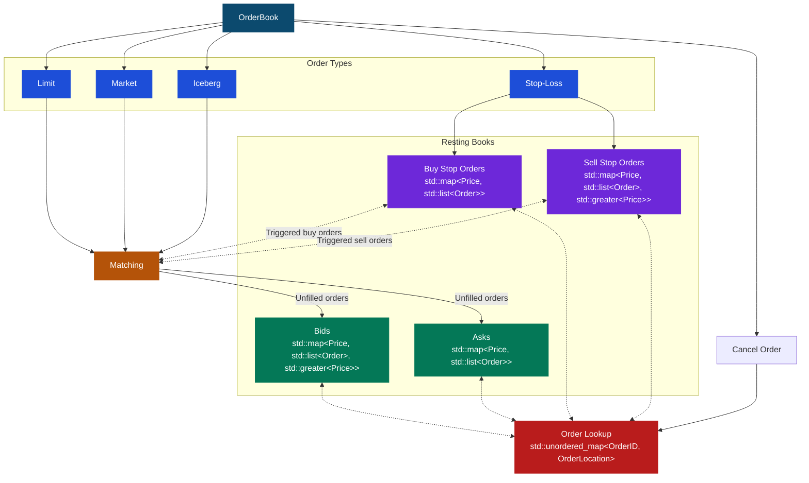

# Limit Order Book

A C++ limit order book with price-time priority matching and an interactive terminal interface. Includes support for limit, market, iceberg, and stop loss order types.  

## Background

An order book maintains all outstanding orders for a financial instrument and efficiently executes trades. Buy orders are called *bids* and sell are called *asks*. In addition, an order book should also be able to efficiently cancel orders, retrieve information from the book (e.g. the spread), and record previous transactions.

Each bid specifies the maximum price an investor is willing to pay, while an ask specifies the minimum price a seller is willing to accept. A trade is executed by matching bids and asks by a set of predetermined matching rules, which may depend on the order type. This order book features *price-time priority*, meaning that best (greatest) bid is matched with the best (least) ask. If there are multiple orders at the same price level then orders are given time priority, i.e. FIFO. Depending on the order type, orders that are not matched may either be discarded or inserted into the book waiting to be matched by future incoming orders. 

The current implementation supports the following order types:
- *Limit Order*: The investor specifies the bid/ask price and the quantity. If an existing ask/bid satisfies those constraints they are matched and an order is executed. If there does not exist such an order then the investor's order is placed into the book until it is matched by an incoming order.
- *Market Order*: The investor specifies the total number of units they would like to buy or sell. They are then matched with the current best priced orders in the book. If there are no orders in the book then the rest of the order is discarded. 
- *Iceberg Order*: The investor specifies the bid/ask price, the quantity, as well as a *peak*. An iceberg order behaves like a limit order with the exception that only the peak amount is shown in the book, with the remaining quantity being hidden. Once a peak has been replenished the order loses its time-priority and is now considered the most recent order. Once the peak amount is fulfilled it is replenished and this continues until the hidden quantity is also fulfilled. 
- *Stop Loss Order*: The investor specifies a *stop loss* and the quantity. A stop loss is a price which triggers a market order; when a trade is executed at or exceeding the stop loss then the stop loss is triggered. In the case of a buy, a stop loss is triggered once a trade is executed at the stop loss or higher. The sell case is analogous.

For more information, see [Optiver: Orders and the Order Book](https://www.optiver.com/insights/explainers/orders-and-the-order-book/).

## Implementation Design

### Orders & Books
Each order is represented by the `Order` struct, which stores its ID, type, side (buy or sell), price, original quantity, and remaining quantity. The price is stored as an `std::optional<Price>` to accommodate market orders. Attributes specific to certain order types, such as the size of an iceberg peak of the price of a stop loss, are stored in `typeSpecificData`, an `std::variant`. For iceberg orders, the amount displayed in the order book is `quantityRemaining`, while `IcebergData::quantityTotalRemaining` stores the true remaining amount, including the displayed portion.  

The unfulfilled bids and asks are implemented as separate `std::map` containers, mapping prices to `std::list<Order>`. This naturally incorporates price-time priority, but naively locating an order can take O(log(P) + N) time, where P is the number of price levels and N is the number of orders at that level. 

To avoid this expensive lookup, we store iterators to the order and its price level, along with other useful data, using the `OrderLocation` struct. Since each order has a unique ID, we use an `std::unordered_map<OrderID, OrderLocation>` to map an ID to an order's `OrderLocation`, allowing for constant time lookups. We will also have an average O(1) cancellations, but this constant time is not guaranteed as if a price level is depleted it must be erased from the red-black tree, which can take O(log P) time. A similar approach is used for stop loss orders.

A high level summary of the implementation design is featured in the figure below.

### Matching & Stop Losses

## Build & Installation

// Mention requirements

## Usage

## Testing

## Performance

